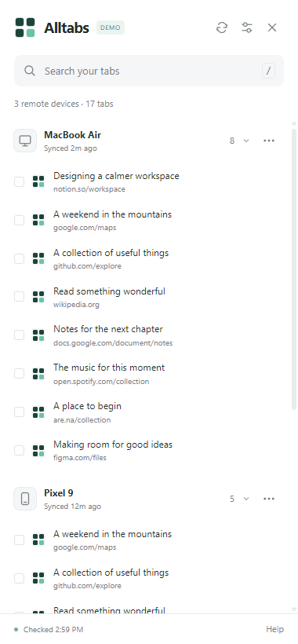

<p align="center"></p>
<h1 align="center">Alltabs</h1>
<p align="center">Your Chrome tabs, across devices. One side panel.</p>
<p align="center"><a href="https://chromewebstore.google.com/detail/alltabs/ikneolohkckpkfmkbplmcneeaaelneoa">Add to Chrome</a> · <a href="https://alltabs.oahz48.com/">Website</a> · <a href="docs/USER-GUIDE.md">User guide</a> · <a href="PRIVACY.md">Privacy</a> · <a href="LICENSE">MIT License</a></p>

Browse tabs from your other devices, search by title or address, and open or copy the links you need—all from a persistent Chrome side panel. Free and open source, with no Alltabs account required.

<p align="center"></p>
<p align="center"><sub>Actual interface · sample data</sub></p>

## Install

[**Install Alltabs from the Chrome Web Store**](https://chromewebstore.google.com/detail/alltabs/ikneolohkckpkfmkbplmcneeaaelneoa), pin its toolbar icon, then click it to open the side panel.

Requires Chrome 141+ on Windows or macOS. Sign into Chrome with the same Google account on your devices and enable history and open-tab sync. Phones supply tabs through Chrome sync; they don't need the extension.

## Features

- Browse synced tabs grouped by device and search by title or address.
- Open individual tabs or a selection, and copy selected links.
- Hide devices and restore them from settings.
- Keep your search and position while opening tabs in the side panel.
- Use light or dark appearance and keyboard controls.

Alltabs reads the snapshots Chrome provides. It cannot force another device to sync, close remote tabs, or show tabs that Chrome does not expose. See the [user guide](docs/USER-GUIDE.md) for setup and troubleshooting.

## Privacy

Tab titles, URLs, searches, and selections are processed locally. Alltabs sends no tab data to developer servers and includes no analytics, tracking, or remote code.

Synced tabs come from Chrome's own sync service. Website icons use Chrome's favicon service, and opening a link connects to the destination website. Those services have their own privacy behavior. Read the [privacy policy](PRIVACY.md).

## Develop

Plain HTML, CSS, and JavaScript. Use Node.js 24 and Chrome; no dependency installation is needed.

To load the development version:

1. Clone or download this repository.
2. Open `chrome://extensions` and enable **Developer mode**.
3. Choose **Load unpacked** and select the `extension` folder.
4. Pin Alltabs, then click its icon to open the panel.

After editing extension files, click **Reload** on its card at `chrome://extensions`, then reopen the side panel. Keep the selected folder in place while using the unpacked extension.

```sh
npm run test
npm run test:browser
npm run test:extension
npm run release
```

`npm run release` runs package validation, unit/package tests, browser checks, and real-extension checks, then creates `dist/alltabs-<version>.zip`. Generated packages and browser profiles are excluded from Git. To test a ZIP, extract it and load that folder unpacked; see the [acceptance checklist](docs/ACCEPTANCE-TEST.md).

Set `ALLTABS_CHROME` if Chrome is installed outside the default Windows location. See [Contributing](CONTRIBUTING.md) for code guidelines, the [changelog](CHANGELOG.md) for version changes, and [release records](docs/RELEASE.md) for publication details.

## Support

[Report a bug](https://github.com/oahz48/alltabs/issues) or email [oahz48@gmail.com](mailto:oahz48@gmail.com). Please use sample data in reports. Report vulnerabilities privately through [SECURITY.md](SECURITY.md).
